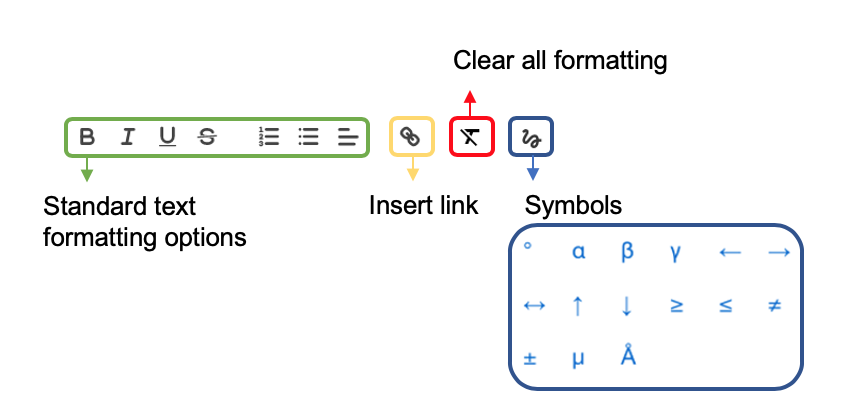
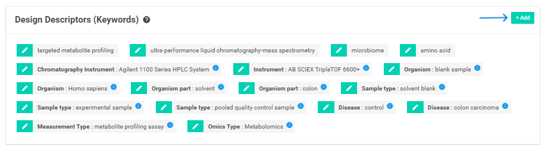
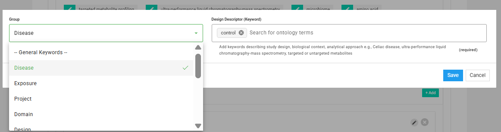
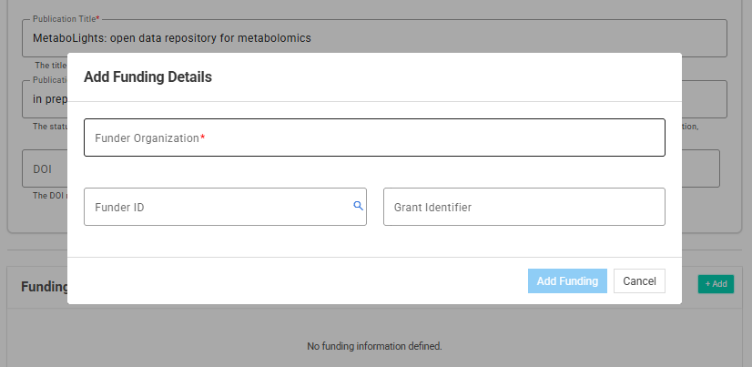
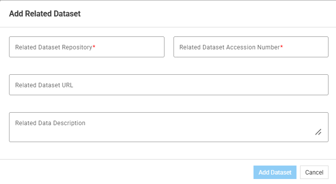

# Study Sections Overview

The first tab in a MetaboLights study is the **Overview** section, which as its name indicates, provides an overview of study-level information, including the Abstract, Publications, relevant Design Descriptors (or Keywords), Funding and Related Datasets.

## Abstract
The abstract should give a brief summary of the study as highlighted below. It is recommended to use the same abstract as the publication.

1) The overall purpose of the study
2) The basic design of the study
3) Major findings or trends found as a result of your analysis
4) A brief summary

### Update Abstract from the publication
Your MetaboLights study abstract can be updated to match your publication abstract.

### Formating abstract
Within the abstract editing section, there will be formatting options available as below.

{width=400}

### Validation rules

* The study abstract should be at least 60 characters long.

---

## Publications
The publication information should match any associated manuscript, include title, abstract, authors and publication status.

### Add publication
Please add your publication details by guided submission or study online editor. The study title, abstract and authors also can be imported using a publication DOI, PubMed or EuropePMC identifier.

### publication status
- In preparation: Publication in preparation before submitting to a journal.
- Submitted: Publication submitted to a journal. 
- Preprint: publications that have URL/DOI for an online copy that can be viewed by anyone but is not the final version.
- Published: Publication published in a journal.

### Validation rules

* The publication title should be at least 25 characters long.
* Provide a list of authors, separated by commas. As appears in the publication, do not include affiliation.
* Only provide the id number, not prefixed with PMID.
* Provide the publication status, this should be at least 5 characters long.

---

## Design Descriptors (Keywords)
Effective keywords for your study portray an accurate representation of what you publish. It also helps MetaboLights search to indexes the study. Keywords should:

 - Represent the content of your manuscript
 - Be specific to your field or sub-field

### Add a Design Descriptor (Keyword)

In the Keywords section, select +Add and choose a category: 'General Keywords' or a specific group, such as Disease, Exposure, or Software. In the 'Design Descriptor (Keyword)' field, enter a term and select the closest matching ontology term from the drop-down list. If no suitable term is available, enter it as free text and press Enter, then select OK to add it.

If a linked publication has been published and has a DOI, you can import its keywords.

{width=700}

{width=700}

/// note 
**You must define at least 3 keywords for your study**
///

### Are there any limits on the number of keywords?

We have no limit on the number of keywords.

## Funding 

Whenever is possible, please provide details of the funding that supported the study, including Funding organization and Grant identifier.

{width=700}

## Related Datasets 

Use this section to link your study to related datasets in MetaboLights or other repositories (e.g., PRIDE, ENA, Metabolomics Workbench, etc.). To create a link, please provide both the repository name and the dataset accession number.

{width=700}

-----------

A MetaboLights study brings together the experimental design, sample descriptions, analytical assays, protocols, metabolite annotations, and associated files. Use the pages in the next sections to learn about each part of a study and the information to provide.

- [Samples](Sample.md): describe the biological materials and sample characteristics.
- [Assays](Assay.md): record the analytical assays and their relationship to samples.
- [Protocols](Protocol.md): document the procedures used to prepare and analyse samples.
- [Metabolites](MAF.md): provide metabolite identification and annotation information.
- [Files](Files.md): upload and manage study data and metadata files.