# Study Submission

## Login and Create New Study
To start a study submission, sign in to your MetaboLights account. On the MetaboLights website, select 'Login/Submit' and enter the email address associated with your account. If you don’t have an account yet, follow the [new user registration instructions](MetaboLights_account.md#new-user-registration).

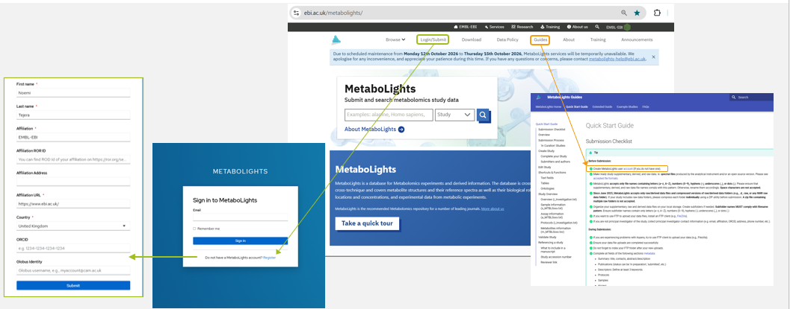{width=75%}

Once you Log in, you will be directed to the [My Studies](https://www.ebi.ac.uk/metabolights/editor/console) page, which provides an overview of all studies you have created in MetaboLights.

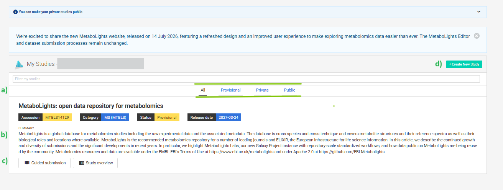{width=800}

* (a) Select to view all studies or studies with a particular status
* (b) View basic outline information for each study including accession number, title, status, release date
* (c) Choose to edit a study using Guided submission or Online editor tools
* (d) Create New Study

Select **'Create New Study'** from the editor console to start a new submission.

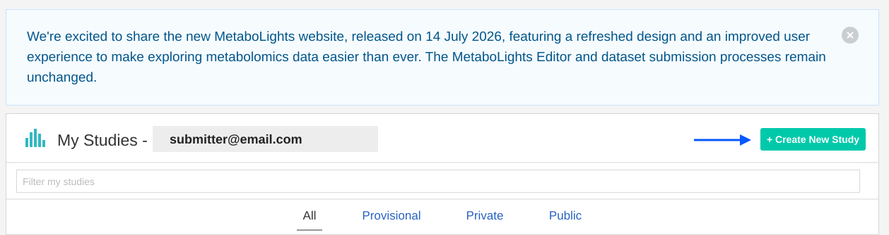

<strong>New feature</strong>: You can now **create a study from scratch**, **clone a public study**, or **clone one of your studies from 'My Studies'**.

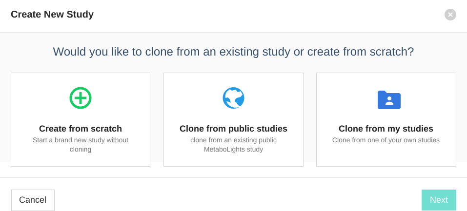{width=75%}

After making your selection, you will see a summary of the main metadata requirements and Data File preparation tips. You can also refer to our guides at any time for help completing each section.

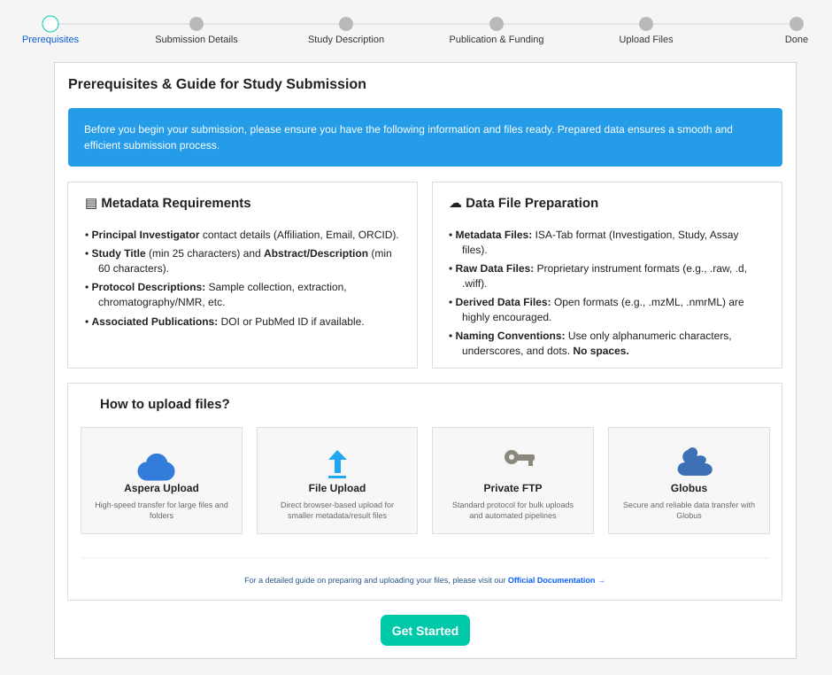

You can upload your raw data files now or later. We recommend starting your submission early and uploading the files when they are ready.

## Study type, Contacts and Data Policy
Next, select the type of study you’re creating. MS data are submitted separately. If you select MS and one other category, such as NMR, MS Imaging, or Other, MetaboLights will create two separate submissions.

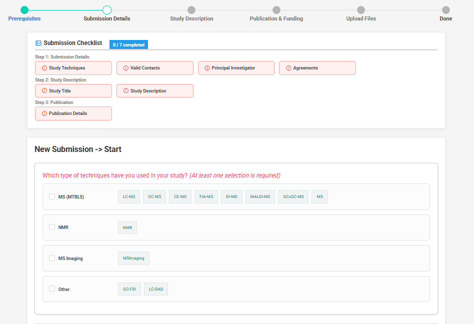{width=75%}

**Contacts** information will need to be provided next. The first name, last name/surname, email address and user role (e.g., Author, Investigator, Principal Investigator, Co-Author, etc.) of at least one author, needs to be added. **Very important** The details for the **'Principal Investigator'** need to be present for the study to pass validations. 

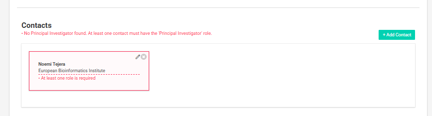{width=75%}

Additional names and details for study authors can be provided in the online editor later on, by selecting **+Add person** in the author section or by providing the manuscript DOI in the publication section and selecting the **Import author** option.

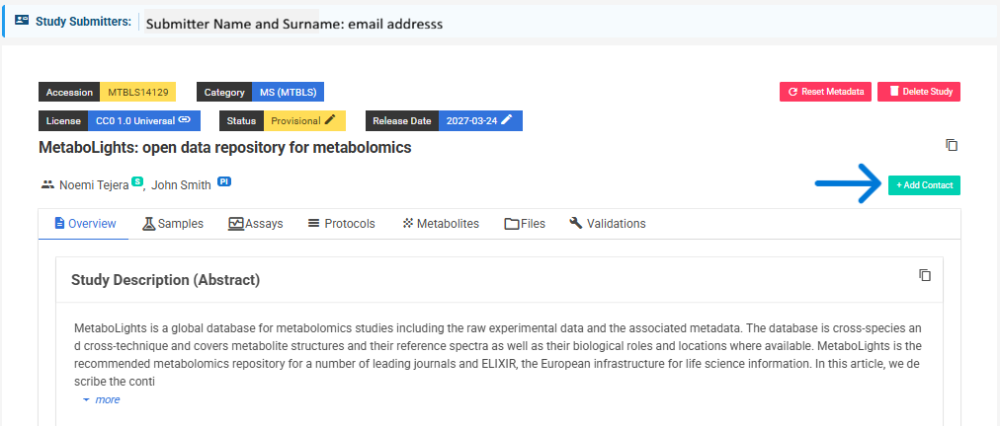{width=700}

### Study access for authors
Submitters are the study creators and editors, they have access and edit rights to the private study during the submission process and correspondence will be directed to the submitter. They will also be the main contact for once the study is public.

Authors are named contributors (as for a manuscript) but will not automatically have edit rights or private access to the study.

The submitter can provide access & edit rights to other authors provided they also have a MetaboLights account. First add as an author (must include email), select name from the author list and then choose **Make Submitter** option.

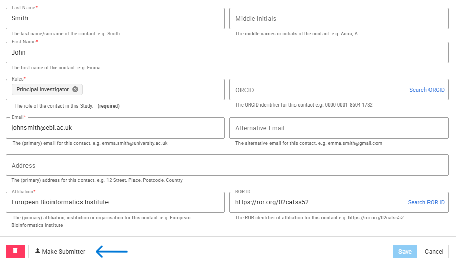{width=500}

Also at this point the new submission wizard will request that you select which **Data policy** works best for your submission: ([CC0 1.0 Universal](https://creativecommons.org/public-domain/#cc0)) or ([CC BY 4.0](https://creativecommons.org/licenses/by/4.0/)). Also, confirm that you have read the [MetaboLights Data Policy](https://www.ebi.ac.uk/metabolights/datapolicy) and that the data are submitted in compliance with all requirements defined in the policy.

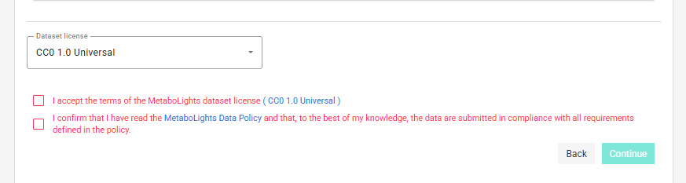{width=75%}

## Study Title, Study Description (Abstract) and Design Descriptors (Keywords)
The next step will be to include a **Study Title**, a **Study Description (Abstract)** and important **Design Descriptors (Keywords)**.

The **Study title** should be clear and concise, ideally the same title as used for the corresponding manuscript.

Submitters can modify a study title in their study later on by selecting the title section and entering in the new title in the dialogue box or by providing the manuscript DOI in the publication section and selecting the **Import title** option.

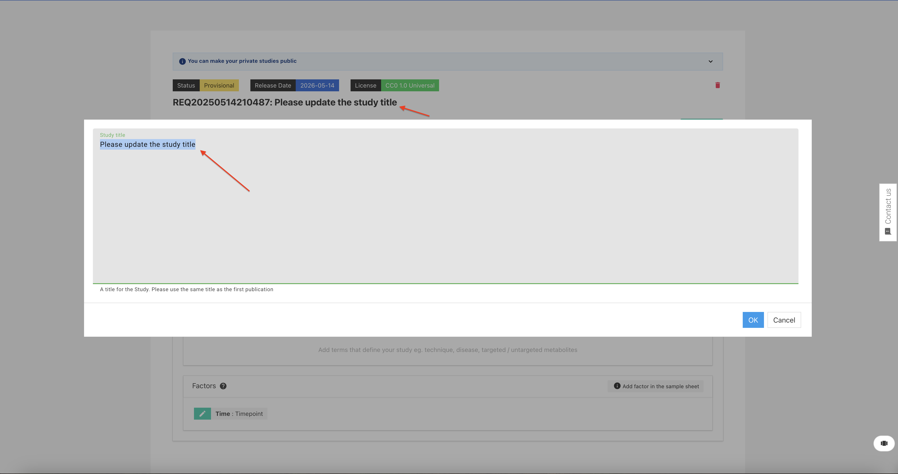{width=600}

For more details regarding **Abstract** and **Design Descriptors**, please check the <a href="/metabolights/Overview/">Overview section</a> of our Guides.

## Publications, Funding and Related Datasets
The next step will be to include **Publication Details**, **Funding** information and **Related Datasets** (if available). Please check the <a href="/metabolights/Overview/">Overview section</a> of our Guides for more information.

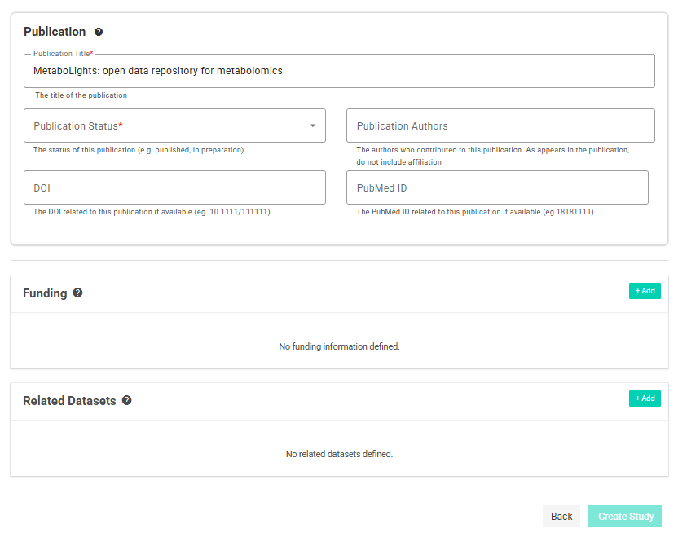{width=700}

**Note:** *You will be issued a temporary identifier (REQxxx). Please refer to this identifier in any communication with the MetaboLights team.*

/// tip |  **MetaboLights APIs**
 You can update your study programmatically using our APIs.
 Try the MetaboLights study title API - [**GET**](https://www.ebi.ac.uk/metabolights/ws/api/spec.html#!/spec), [**PUT**](https://www.ebi.ac.uk/metabolights/ws/api/spec.html#!/spec) using our [swagger interface](https://www.ebi.ac.uk/metabolights/ws/api/spec.html#!/spec).

/// 

/// question | More question
 Can't find what you are looking for? Check out our [FAQ's](FAQs.md#maf) for most commonly asked questions and solutions.
///

## Delete a Study or Reset Metadata
As a <strong>New Feature</strong>, Submitters can now **Delete** their Provisional Studies. 

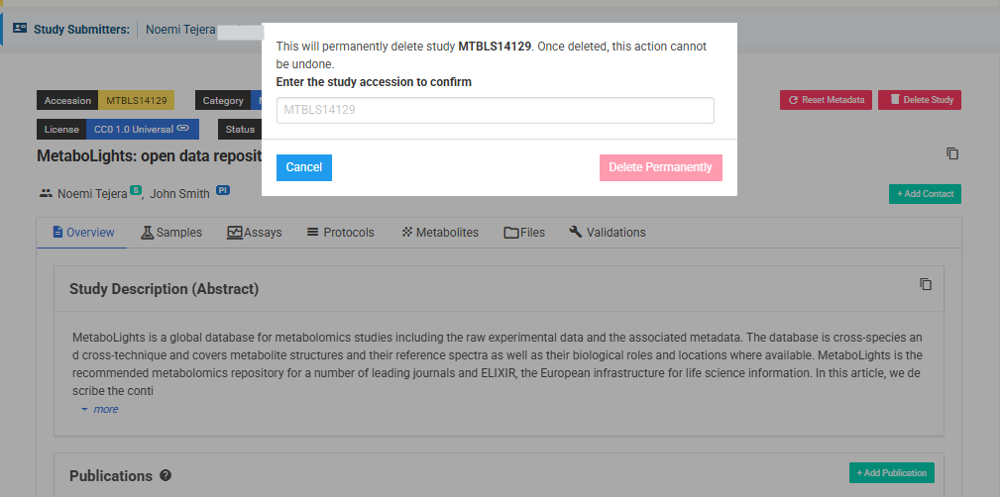{width=700}

As an alternative to deleting the Provisional submission, a submitter can **Reset the Metadata**. As the name indicates, this new feature will reset all metadata files for the selected Provisional study.

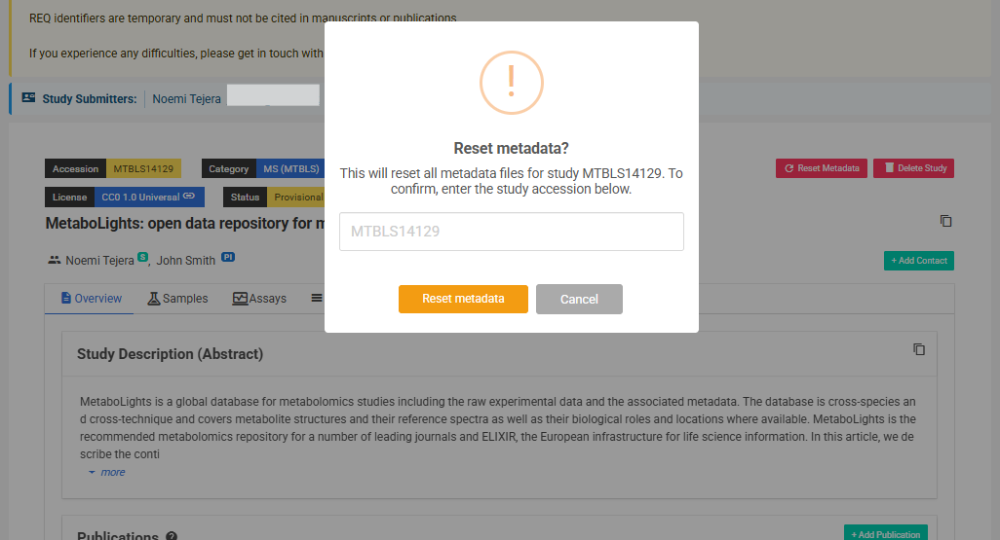{width=700}

---

